<div align="center">

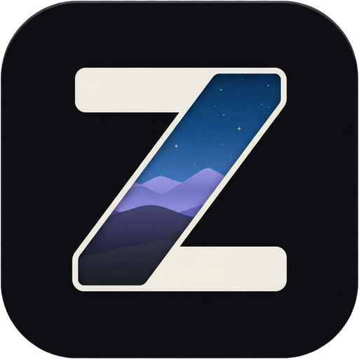

# ZWall

**Free, open-source live wallpapers for Linux and Windows.**<br/>
Animated, interactive and 3D wallpapers, a real wallpaper library, automations, desktop widgets,<br/>
and multi-monitor blending. A Wallpaper Engine alternative that runs natively on KDE Plasma.

[](https://github.com/TheHolyOneZ/ZWall/releases)
[](LICENSE)
[](#where-it-runs)
[](#where-it-runs)
[](#how-its-built)
[](#how-its-built)

[**Homepage**](https://zsync.eu/zwall/) · [**Download**](https://github.com/TheHolyOneZ/ZWall/releases) · [**Features**](#features) · [**Screenshots**](#a-tour-of-zwall) · [**Install**](#install) · [**FAQ**](#faq)

<br/>

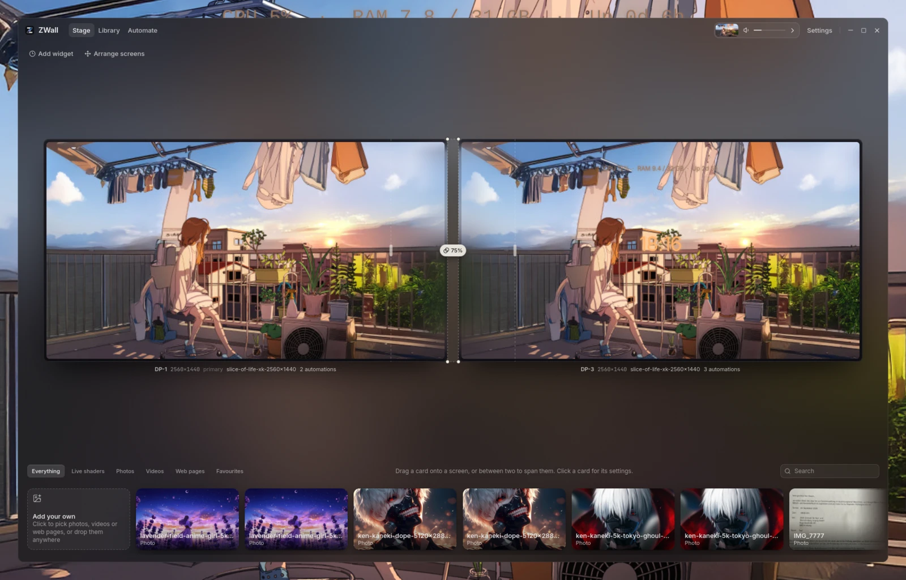

<sub>The Stage: your monitors to scale, your wallpapers on the shelf. The ZWall window itself is frosted glass over your desktop.</sub>

</div>

---

## Why ZWall

- **It's yours.** Free, open source (GPL-3.0), no account, no tracking, no telemetry. Everything runs on your computer.
- **It's native on Linux.** Built for KDE Plasma first, where it renders *inside* Plasma, so your desktop icons and panels stay exactly where they are.
- **It does more than play wallpapers.** It organises them like a photo library, changes them on its own schedule, puts clocks and info on top, and blends neighbouring monitors into one desk.
- **It stays out of the way.** It pauses for games, fullscreen apps, battery and a locked screen, and uses 0% GPU while paused.

## Contents

- [A tour of ZWall](#a-tour-of-zwall)
- [Features](#features)
- [ZWall vs Wallpaper Engine](#zwall-vs-wallpaper-engine)
- [Where it runs](#where-it-runs)
- [Install](#install)
- [Build from source](#build-from-source)
- [How it's built](#how-its-built)
- [FAQ](#faq)
- [Privacy](#privacy)
- [Roadmap](#roadmap)
- [Licence and credits](#licence-and-credits)

---

## A tour of ZWall

### Stage: your desk, to scale

Drag a wallpaper from the shelf onto a screen to play it there. Drop it in the gap between two screens to **span** one picture across both. Click any wallpaper to tune it, and changes show on your real desktop as you make them.

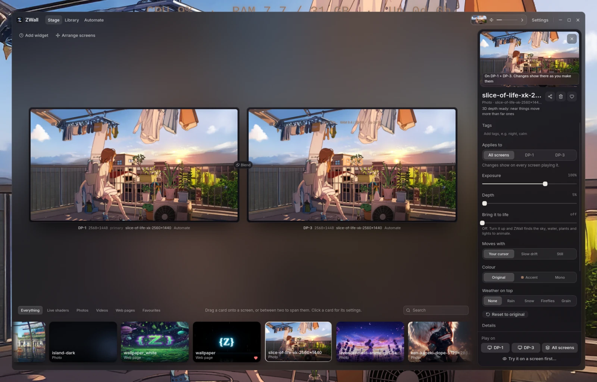

### Widgets: clocks, date and info on your wallpaper

Add a clock (digital, minimal, analog or words), the date, your own text, CPU and memory, or battery. Drag them onto the screen previews, resize them by the corner, pick any installed font, a colour scheme or your own colour, and a soft shadow or glow.

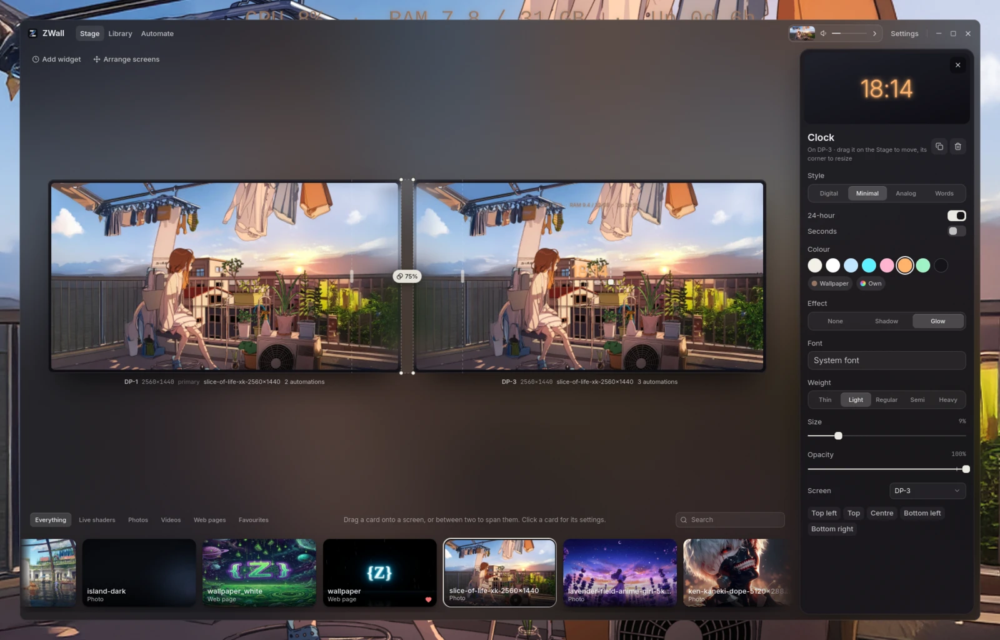

<table>
<tr>
<td width="50%">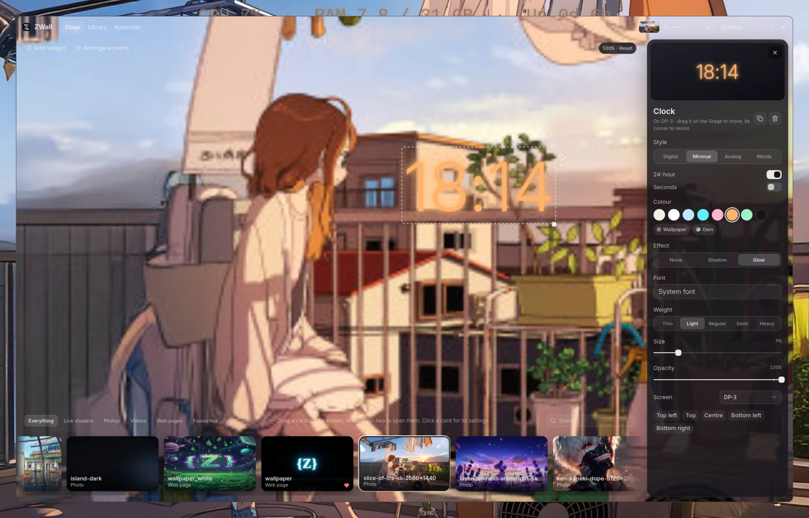<br/><sub><b>Zoom in</b> on the Stage around your mouse to place things precisely; alignment guides snap widgets to the centre, the thirds and each other.</sub></td>
<td width="50%">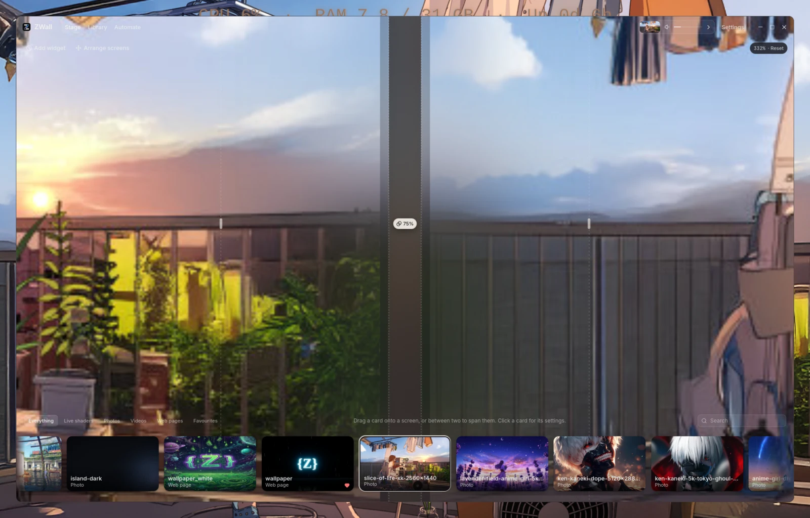<br/><sub><b>Blend where screens meet</b>: drag the seam's lines and dots to choose how far and where two wallpapers flow into each other.</sub></td>
</tr>
<tr>
<td width="50%">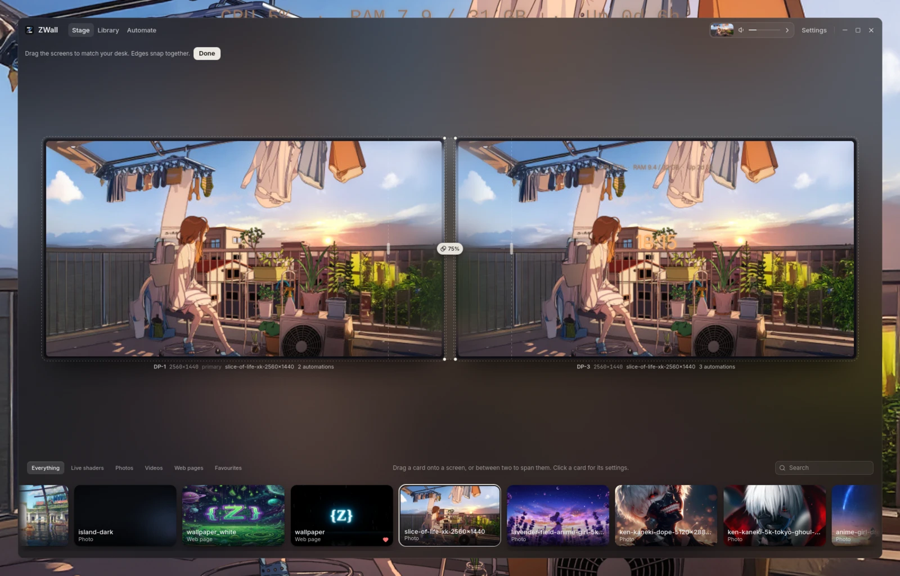<br/><sub><b>Arrange screens</b> to match how your monitors really stand (heights, bezel gaps). Spans and blends follow.</sub></td>
<td width="50%">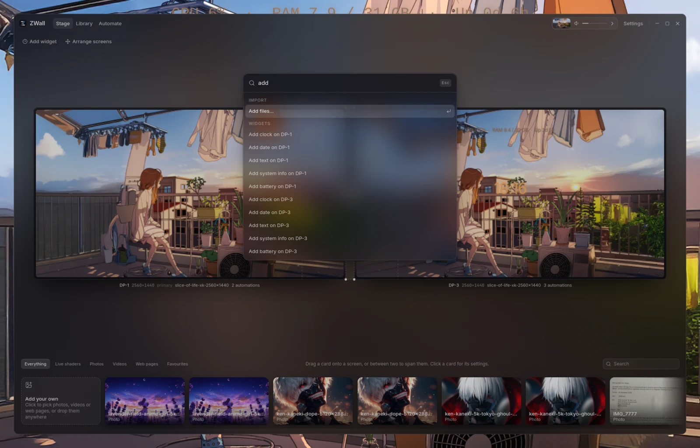<br/><sub><b>Ctrl+K</b>: everything ZWall can do, one search away.</sub></td>
</tr>
</table>

### Library: browse, search and organise

Search by name, tag, type, author or size words like "4k". Filter by collection, type, resolution and shape. Select several wallpapers and drag them onto a tag or collection. Every row in the sidebar can be reordered, folded or hidden.

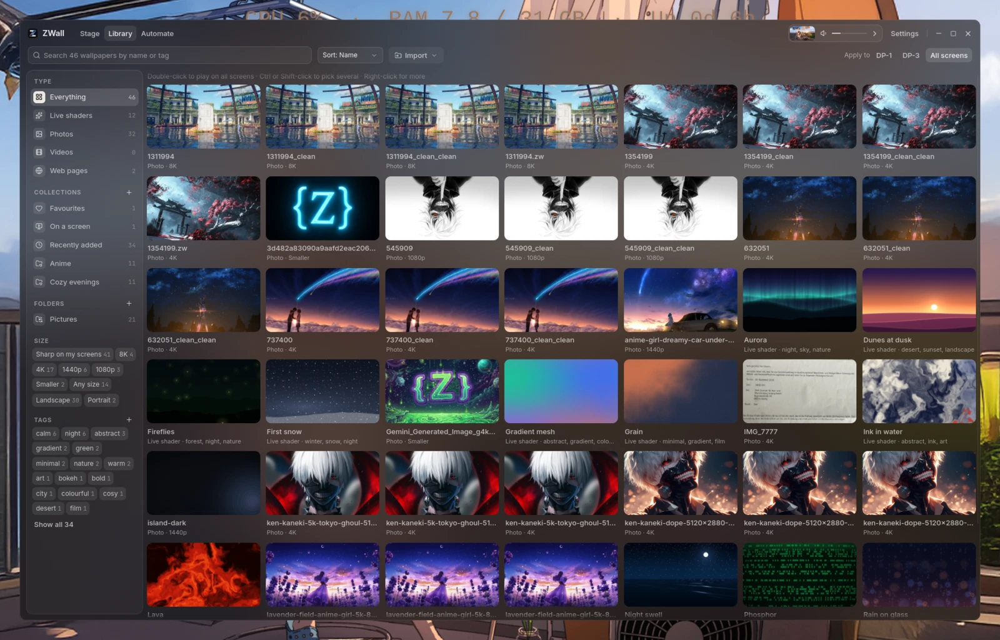

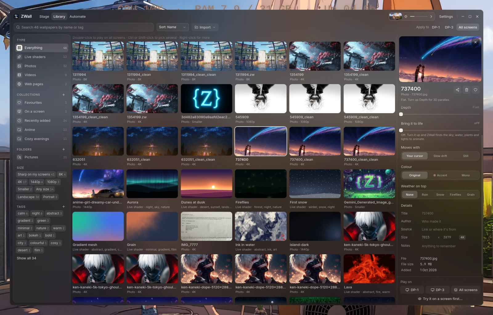

### Automate: wallpapers that change by themselves

Every automation reads like a sentence: *"At 07:00 every day on all screens, play a random one from Anime."* Click any word to change it. The day line shows when things happen; drag a moment to move it.

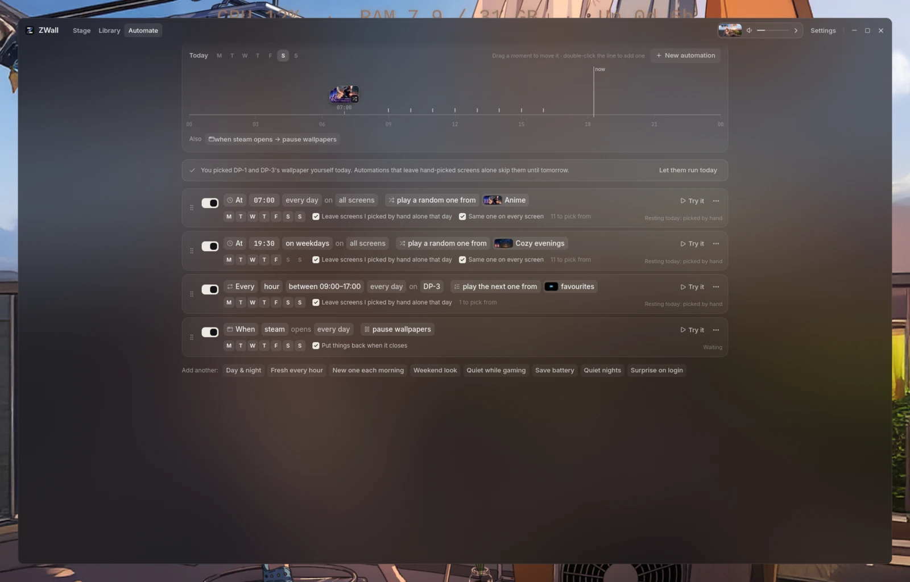

### Settings and About

<table>
<tr>
<td width="50%">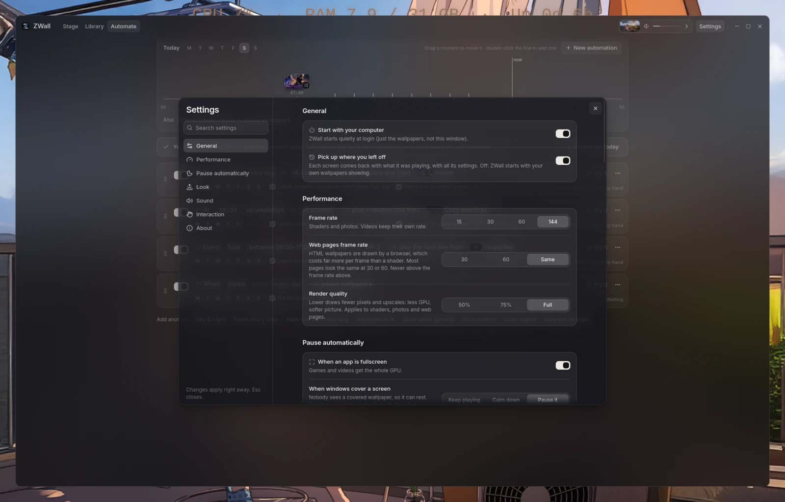</td>
<td width="50%">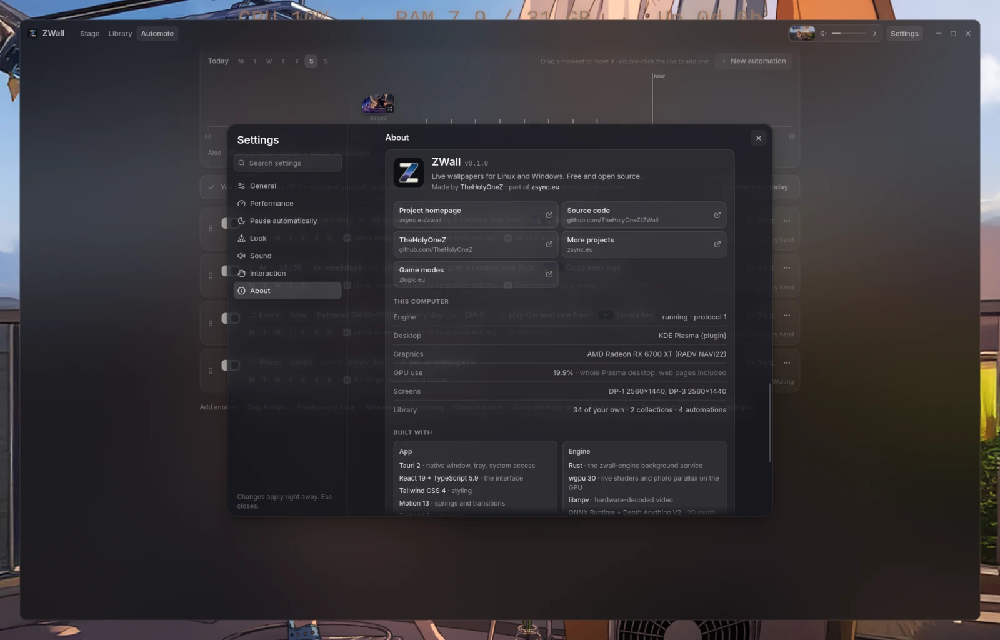</td>
</tr>
</table>

<div align="center">
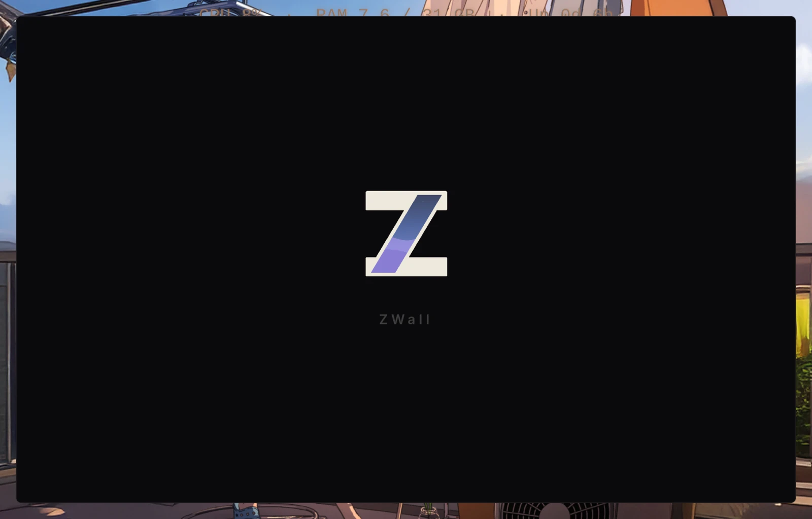<br/>
<sub>A three-second intro when ZWall opens (skippable, can be turned off).</sub>
</div>

---

## Features

### Wallpaper types

- **Live shaders**: 12 built-in animated wallpapers (Aurora, Rain on glass, Starfield, Lava, Fireflies, Gradient mesh, Dunes at dusk, Night ocean, First snow, Ink in water, Grain, Phosphor CRT) that render at any resolution.
- **3D photo wallpapers**: any photo gets **real depth parallax**. A local AI depth model (Depth Anything V2 Small, runs on your computer) finds what's near and far, and near things move more as your mouse moves.
- **"Bring it to life"**: ZWall recognises the sky, water, plants and lights in a photo and animates them gently.
- **Video wallpapers**: mp4, mkv, webm, mov and gif; hardware-decoded, looping, **with sound** (only one copy of a video is ever heard).
- **Seamless loop maker**: trim a video, let ZWall find the best loop point, and blend the seam.
- **Web / HTML wallpapers** (KDE Plasma): any web page or HTML folder as a wallpaper. It gets your mouse and desktop clicks, Wallpaper Engine web wallpapers work, and a built-in **frame limiter** keeps the GPU cost down.
- **Weather layers** on top of any wallpaper: rain on the glass, snow, fireflies, film grain, with adjustable strength.

### Make every wallpaper yours

- Live controls: speed, exposure, depth, motion (follows your cursor, drifts slowly, or stays still), colour (original, your accent, or monochrome), weather.
- **Different looks per screen** for the same wallpaper.
- **Try before you apply**: preview a wallpaper on a screen and keep it or go back.
- **Time-of-day grading**: warm at dawn and dusk, cool and dim at night.
- **Accent colour from the wallpaper** (KDE Plasma, optional): your desktop accent follows what's playing.
- **Click ripples**: clicking the desktop sends a ripple through shader and photo wallpapers.

### Multi-monitor

- Every screen gets its own wallpaper, or **span** one picture across several.
- **Arrange screens** on the Stage to match how they physically stand (different heights, bezel gaps). Spans line up with reality.
- **Edge blending**: where two different wallpapers meet, their colours flow into each other. Per seam you choose how far it reaches into each screen, which stretch of one edge meets which of the other, and how strong it is.

### Library

- Grid of everything: your photos, videos, web pages and the built-in shaders.
- **Search** by name, tag, type, author, original file name and size words ("4k", "portrait").
- **Sort** by name, newest, type or size.
- **Collections**: smart ones (Favourites, On a screen, Recently added) and your own. Drag wallpapers onto them.
- **Tags**: create, rename, delete, drag wallpapers onto a tag or move them between tags; the shaders come with tags built in.
- **Size filters**: 8K, 4K, 1440p, 1080p, smaller, "sharp on my screens", ultrawide / landscape / portrait.
- **Editable details**: title, author, source link, notes and resolution, plus detected size, file size, length and date added.
- **Multi-select** (Ctrl/Shift-click), keyboard navigation, right-click menus everywhere, and **Undo** for deletions.
- **Customisable sidebar**: drag sections and rows to reorder them, fold them, or drag them off to hide them.
- **Batch import** from folders, with a preview of what comes in.
- **Wallpaper Engine import**: finds your Steam Workshop folder automatically and brings over video and web wallpapers with their tags.

### Watched folders

- Point ZWall at folders (Downloads, a wallpaper drive…) and **new files show up in your library by themselves**.
- Per folder: which types to take, subfolders or not, which collection to file them in, which tags to add, and whether deleted files leave the library.
- Removing one by hand means it's never re-added; unplugged drives are handled safely.

### Automations

- **Triggers**: at a time of day, every N minutes (optionally only between certain hours), when an app opens, when the charger is unplugged or plugged in, when ZWall starts.
- **Actions**: play a specific wallpaper, a random one or the next one from a collection, tag, type or your favourites; pause, resume, mute, unmute or set the volume.
- **Days of the week**, **which screens**, and **"leave screens I picked by hand alone that day"**.
- **"Put things back afterwards"** for app and charger triggers (e.g. pause while Steam runs, resume when it closes).
- A **24-hour day line** you can drag moments on, ready-made starting points (Day & night, Fresh every hour, Quiet while gaming, Save battery…), and **Try it** buttons.

### Desktop widgets

- **Clock**: digital, minimal, analog or words ("quarter past nine"); 12/24-hour, seconds.
- **Date**, **your own text**, **system info** (CPU, memory, uptime, live), **battery**.
- Any **installed font**, weight, size, opacity, colour schemes, your own colour, or "follow the wallpaper", plus shadow or glow.
- Drag to place, corner to resize, **smart alignment guides**, **zoom** for pixel-precise placement.

### Smart pausing and performance

- Pauses automatically for **fullscreen apps and games**, programs you choose, **battery** (or a battery saver mode), **idle**, and a **locked screen**.
- Screens **covered by windows** can pause or calm down on their own.
- **Mutes wallpaper sound** while another app plays audio.
- Frame rate cap, **separate web page frame rate**, render quality (50–100%).
- **0% GPU while paused.**

### The app

- **Frosted-glass window** that shows your desktop through it (KDE Plasma blur, Windows Acrylic), rounded and dark.
- **Tray icon** with pause, mute, next wallpaper, live GPU use, and "Quit ZWall completely" (which gives your own wallpapers back). Closing the window keeps wallpapers playing.
- **Now-playing capsule** in the title bar: click the thumbnail to pause, drag the line for volume, › for next.
- **Command palette** (Ctrl+K), searchable Settings, keyboard shortcuts (Space, M, N), and global shortcuts (Super+Alt+P / M / N).
- **Start with your computer**, and **pick up where you left off** after a restart.
- **Screensaver**: your wallpaper full screen after you've been idle for a while.

### Sharing: `.zwall` files

- One file holds a wallpaper and its look, readable and documented (a zip with a `manifest.toml`).
- **Lossless compression**: JPEG photos are stored as JPEG XL, about **17% smaller**, and restored **byte for byte** on import.
- Drop a `.zwall` on the window to import it.

---

## ZWall vs Wallpaper Engine

| | ZWall | Wallpaper Engine |
|---|---|---|
| Price | **Free** | Paid (Steam) |
| Open source | **Yes** (GPL-3.0) | No |
| Linux | **Native** (KDE Plasma, Hyprland/wlroots, GNOME) | No (Windows only) |
| Windows | Yes | Yes |
| Account / Steam needed | **No** | Yes |
| Video, web and shader wallpapers | Yes | Yes |
| 3D depth from any photo (local AI) | **Yes** | Via its editor |
| Automations (time, days, app opens, charger) | **Yes** | Playlists (timer, time of day) |
| Watched folders | **Yes** | No |
| Library: collections, size filters, editable details | **Yes** | Workshop filters |
| Multi-monitor edge blending | **Yes** | No |
| Desktop widgets (clocks, info) | Yes | Via scene wallpapers |
| Scene editor (particles, layers) | Planned | **Yes** |
| Huge content library (Steam Workshop) | No (imports WE video/web) | **Yes** |
| Audio-reactive wallpapers | Not yet | **Yes** |

---

## Where it runs

| Desktop | Status |
|---|---|
| **KDE Plasma 6, X11** | **Full support.** Renders inside Plasma through the ZWall wallpaper plugin (installed automatically), so icons and panels stay intact. Every feature works here. |
| **KDE Plasma 6, Wayland** | Supported through the same plugin. Cursor parallax drifts instead of following the mouse, and fullscreen/covered detection and click ripples aren't available yet. |
| **Hyprland / wlroots (Sway, river…)** | Supported via wlr-layer-shell: photo, video and shader wallpapers, pausing, automations, library. Edge blending, widgets and web wallpapers are KDE Plasma features. |
| **GNOME (X11 / Wayland)** | Supported via the bundled GNOME Shell extension, which ZWall installs and enables for you (on Wayland, log out and back in once after the first start). |
| **Other X11 desktops** | Wallpapers via a desktop window. Desktops that draw icons in their own window (XFCE, Cinnamon) will have them covered. |
| **Windows 10 / 11** | Supported: wallpapers behind the desktop icons (WorkerW, including Windows 11 24H2), per-monitor DPI, smart pausing, video via mpv, start with Windows, Acrylic window. Web wallpapers are a KDE Plasma feature for now. |

Features that need the KDE Plasma plugin (web wallpapers, widgets, edge blending, screen arrangement) only appear where they work.

---

## Install

> **Version 0.1.2** fixes missing thumbnails for imported videos on Windows. **Version 0.1.1** fixed the wallpaper engine not starting after install on Linux and Windows. If you installed 0.1.0, please update. Packages appear on the [Releases page](https://github.com/TheHolyOneZ/ZWall/releases) and at [zsync.eu/zwall](https://zsync.eu/zwall/). What changed: [CHANGELOG.md](CHANGELOG.md).

**Linux runtime needs:** WebKitGTK 4.1, libmpv (video wallpapers), and optionally ffmpeg (moving video previews and the loop maker), Chromium or Chrome (web page previews) and libjxl's `cjxl` (smaller `.zwall` exports).

Arch Linux / Manjaro / EndeavourOS:

```sh
sudo pacman -S webkit2gtk-4.1 mpv ffmpeg libjxl
```

Debian / Ubuntu:

```sh
sudo apt install libwebkit2gtk-4.1-0 libmpv2 ffmpeg libjxl-tools
```

**Windows:** the installer bundles the engine and the Microsoft Visual C++ runtime it needs, so nothing else has to be installed. Video wallpapers need mpv (bundled when available, otherwise `scoop install mpv`).

---

## Build from source

You need Rust (stable), Node.js 20+ and pnpm. On Linux also the WebKitGTK and libmpv development packages.

```sh
git clone https://github.com/TheHolyOneZ/ZWall.git
cd ZWall
pnpm install

pnpm engine        # terminal 1: the wallpaper engine (cargo run -p zwall-engine)
pnpm tauri dev     # terminal 2: the app

pnpm dev           # the app alone in a browser, with a mock engine
cargo test --workspace
pnpm release       # a shippable build for the platform you're on (installer + bundled engine)
```

`zwall-engine --probe` prints what the engine sees (backend, monitors, fullscreen, idle, battery). Settings and your library live in `~/.config/zwall/engine.json` (Windows: `%APPDATA%\ZWall`).

---

## How it's built

ZWall is two programs: a small **engine** that owns the wallpapers and keeps running when the window is closed, and the **app**, which is just a client of the engine.

| Part | What it does |
|---|---|
| `crates/zwall-engine` | The wallpaper engine (Rust): backends for KDE Plasma, X11, Wayland layer-shell, GNOME and Windows; automations, watched folders, pausing, edge blends, widgets data. |
| `crates/zwall-render` | GPU rendering with **wgpu**: the live shaders and photo parallax. |
| `crates/zwall-depth` | Photo → depth map with **ONNX Runtime** and Depth Anything V2 Small, entirely local. |
| `crates/zwall-format` | The `.zwall` format (zip + `manifest.toml`), lossless JPEG XL packing, folder scanning. |
| `crates/zwall-ipc` | The engine ⇄ app protocol: JSON over a local socket (named pipe on Windows). |
| `kde-wallpaper/` | The KDE Plasma wallpaper plugin (QML, Qt Quick, Qt WebEngine) that draws inside Plasma. |
| `gnome-extension/` | The GNOME Shell extension. |
| `src-tauri/`, `src/` | The app: **Tauri 2**, **React 19**, **TypeScript**, **Tailwind CSS 4**, **Motion**, **Zustand**, **Vite**. |

Also used: libmpv (video), ffmpeg (previews, loops), x11rb, smithay-client-toolkit, zbus, jxl-oxide (pure-Rust JPEG XL decoding).

---

## FAQ

**The app says "The wallpaper engine is asleep" and it won't wake up.**<br/>
That was a packaging bug in 0.1.0: on Linux the engine was installed without permission to run, and on Windows it was missing the Visual C++ runtime. Update to 0.1.1. On 0.1.0 you can work around it with `sudo chmod +x /usr/bin/zwall-engine` (Linux) or by installing the [Microsoft Visual C++ Redistributable (x64)](https://aka.ms/vs/17/release/vc_redist.x64.exe) (Windows). From 0.1.1 the app starts the engine by itself, and if the engine can't start, the app tells you why. The engine's log is at `~/.local/share/zwall/engine.log` (Linux) or `%LOCALAPPDATA%\ZWall\engine.log` (Windows).

**Is ZWall a Wallpaper Engine alternative for Linux?**<br/>
Yes. It plays animated, video, web and shader wallpapers natively on Linux, and imports Wallpaper Engine's video and web wallpapers from your Steam library. It doesn't run Wallpaper Engine *scene* wallpapers.

**Does it work on KDE Plasma 6?**<br/>
Yes, and that's where it's best. ZWall installs a Plasma wallpaper plugin and renders inside Plasma, so your desktop icons, widgets and panels keep working.

**Does it work on Wayland?**<br/>
Yes on KDE Plasma Wayland (through the plugin) and on Hyprland and other wlroots compositors (through layer-shell), with a few limits listed in [Where it runs](#where-it-runs).

**Will it slow down my games?**<br/>
No. ZWall pauses itself when a game or any app goes fullscreen, and uses 0% GPU while paused. You can also cap the frame rate, lower render quality, or have it pause whenever a specific program runs.

**Can I use my own photos and videos?**<br/>
Yes: drop files or folders onto the window, use Import, or set up watched folders so new files come in by themselves.

**What happens to my original wallpaper?**<br/>
ZWall remembers it. Clear a screen, or choose "Quit ZWall completely" from the tray, and your own wallpaper comes back.

**Is it free?**<br/>
Yes, and open source under the GPL-3.0. No account, no ads, no tracking.

---

## Privacy

ZWall has **no accounts, no analytics and no telemetry**. Your library, settings and wallpapers stay on your computer. The only download is the depth model (Depth Anything V2 Small, about 27 MB), once, the first time you use 3D depth. Web wallpapers are web pages and can load whatever they're written to load, so use pages you trust.

## Roadmap

Planned next:

- **Wallpaper gallery** on [zsync.eu](https://zsync.eu): share and download `.zwall` wallpapers in one click.
- **Scene editor**: layer particles, light, depth layers and widgets over a photo or video.
- **Audio-reactive wallpapers** that move with your music.
- **Smooth transitions** when wallpapers change, and **sunrise/sunset automations**.
- **Weather and now-playing widgets**, and **auto-updates**.

## Licence and credits

ZWall is free software under the **GNU General Public License v3.0 or later**. See [LICENSE](LICENSE).

Made by [**TheHolyOneZ**](https://github.com/TheHolyOneZ). More projects at [zsync.eu](https://zsync.eu) · game modes at [zlogic.eu](https://zlogic.eu) · homepage at [zsync.eu/zwall](https://zsync.eu/zwall/).

Depth model: [Depth Anything V2 Small](https://github.com/DepthAnything/Depth-Anything-V2) (Apache-2.0).

<div align="center"><sub>If ZWall makes your desktop nicer, a ⭐ on GitHub helps other people find it.</sub></div>
